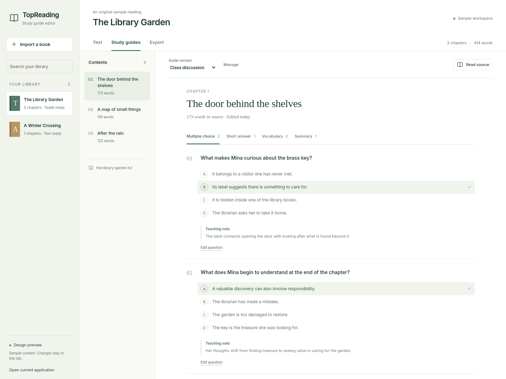

# UI prototype and PostgreSQL migration foundation

Implemented on 2026-10-23. This is the first implementation slice after the [production restore rehearsal](production-baseline-findings.md).

## Try the prototype

Run the existing application with Node 22:

```sh
npm ci
npm run dev
```

Open `/prototype` on that development server. The saved-book application at `/` now uses the approved layout; the earlier interface is available at `/legacy`. See [live integration status](live-workspace-integration.md).

Inside a book, the prototype has three destinations: Text, Study guides, and Export. A header book switcher and a separate searchable Library view replace the persistent library sidebar. Only the chapter outline remains beside Text and Study guides; Export uses that space for its settings. It starts with fictional readings and now saves preview books and drafts locally on the device, including across reloads. See [implemented UI behaviors and MCQ quality checks](ui-behaviors-and-mcq-quality.md) for persistence, recovery, version and quality behavior. It makes no API requests, changes no application records, and makes no AI calls.

Try these tasks:

1. Import a UTF-8 TXT file (up to 2 MB). Review suggested chapters, including any opening pages. Edit titles and text, split at the cursor, and merge adjacent chapters.
2. Choose a guide version. Edit a question and its correct answer, add an item, and switch versions to check that their edits stay separate. Open the source text beside the questions. Create a new sample guide through Text or Manage.
3. Choose Export, select chapters and content, and toggle answers. Use the browser print dialog to print or save a PDF.
4. Open Library from the header and search by title or author. Return to the current book, or switch books using the header selector. Within this tab, each book retains its chapter, guide version, content type, source visibility, and question draft. On a phone, use the same header controls and the chapter picker.

This slice establishes layout and interactions. It does not yet implement server-synchronized saving, actual AI generation in the prototype, PDF/EPUB extraction, DOCX export in the prototype, or production worker recovery. Those remain in the [modernization plan](modernization-plan.md). Sample questions created from imported text are placeholders for exercising the workflow.



[Library view](prototype/library.png) · [Phone layout](prototype/mobile.png) · [Handout preview](prototype/export.png)

## Design decisions before backend integration

The single-sidebar layout and prototype behavior implementation are complete; see [implementation scope and verification](ui-behaviors-and-mcq-quality.md). The following requirements also guide production integration:

- **Saving and navigation:** show persistent Saving / Saved / Could not save feedback near the editor; preserve failed edits with a Retry action. Keep unsaved question drafts when navigating, and make reload/leave protection explicit. Restore book, task, chapter, and guide through URL state in the real app. The prototype now saves keyed drafts locally across navigation/reload; production server saving remains to be connected.
- **Reversible chapter changes:** offer immediate Undo after splitting or merging, plus revision history. Review proposed boundaries before replacing the chapter structure. Each operation must be atomic and preserve the text; confirmation is appropriate for replacement or deletion rather than every ordinary edit.
- **Generation and source changes:** generate into a new guide version by default, preserving manual edits. Separate Queued / Generating / Ready / Failed from Needs review after a source edit. Record the source revision each generated item used; retry failed work without duplicating completed items. Legacy provenance remains unknown.
- **Output intent:** name student handouts and teacher copies explicitly, show the selected guide/chapter scope, and make answer inclusion visible in the preview. Preserve the existing standalone answer-key formats when production exports are connected.
- **Accessibility and language:** check keyboard focus, readable contrast, touch targets, long titles, Korean text, and dark mode before replacing the current UI. Keep source comparison optional and within the workspace; do not add another permanent navigation sidebar.

These behaviors guide the data-access, revision, and job APIs. Further visual polish can happen alongside implementation; the layout does not need another major redesign before those foundations begin.

## PostgreSQL scope

`database/migrations/0001_postgres.sql` is the initial migration-owned SQL schema. `scripts/migrate-postgres.py` imports an existing verified SQLite snapshot into a separate PostgreSQL schema. This does **not** switch the web application to PostgreSQL. Its current Drizzle queries and startup schema logic still require SQLite; do not change the runtime `DATABASE_URL` to a PostgreSQL URL yet.

The foundation preserves all 12 legacy tables and their IDs, text, active guide selections, summaries, question answers, settings, and timestamps. JSON becomes JSONB and timestamps become timezone-aware values; reconciliation compares their normalized meaning, not their old textual serialization.

It also adds:

- An initial shared library, with each existing user assigned a membership preserving their role. Disabled accounts remain disabled. This reflects the current shared-library model and must be reviewed before the authentication cutover.
- One immutable text snapshot per current chapter, with a stable revision ID and content checksum. Historical generated items keep an unknown revision link; the importer does not invent which text was used to generate them.
- Same-book constraints for active guide selections, study sets, and generated items; typed UUIDs and answer-index checks.
- Storage metadata for a later private object-store transition. Files remain local; this command does not upload or move them.
- Job-table scaffolding and a migration ledger. Worker claiming, retries, authorization, sessions, invitations, provider identities, stored exports, and Drizzle PostgreSQL mappings are subsequent work.

The SQL schema currently retains the legacy chapter text columns alongside the current revision pointer. The PostgreSQL adapter must update both atomically, enforce library membership on every query, and implement deliberate deletion/version-retention behavior before it replaces the live adapter. Database constraints alone are not user authorization.

## Rehearse an import

Use PostgreSQL 17 and a **dedicated rehearsal database**, with a database role allowed to create schemas. Work from a quiesced, verified backup with its matching uploaded files, not the live SQLite database. Keep the source snapshot unchanged during verification and import.

Install the separate migration dependency into a Python virtual environment:

```sh
python -m pip install -r requirements-migration.txt
```

Dry-run verification needs no PostgreSQL connection:

```sh
python scripts/migrate-postgres.py \
  --database /path/to/verified/topreading.sqlite \
  --uploads /path/to/verified/uploads \
  --schema topreading_rehearsal
```

Set `MIGRATION_DATABASE_URL` privately to the dedicated target connection string. The importer deliberately ignores the application's `DATABASE_URL`. Then apply:

```sh
python scripts/migrate-postgres.py \
  --database /path/to/verified/topreading.sqlite \
  --uploads /path/to/verified/uploads \
  --schema topreading_rehearsal \
  --apply > postgres-reconciliation.json
```

The importer verifies the source, creates the schema, loads records, creates revisions/memberships, checks constraints, and reconciles every original column before committing. A failure rolls back the entire new schema. It never modifies the source database or uploads. It refuses unknown source tables and baseline warnings rather than silently omitting data.

Running the exact command again verifies the existing target and returns `verified_existing`; it does not reinsert or overwrite records. A different snapshot, changed migration SQL, unrelated existing schema, or edited target is refused. Use a fresh schema for another rehearsal. There is no force-overwrite option.

This is a bootstrap importer, not an ongoing synchronization process. Later schema changes must be separate versioned migrations once the foundation is deployed.

## Verification evidence

The production build and TypeScript checks pass. Chromium workflow checks pass at desktop (1440 × 1080) and phone (390 × 844) sizes, covering version-specific edits, dialog dismissal, TXT import, split/merge, sample guide creation, mobile chapter/library navigation, and printing. The single-sidebar revision also passed library title/author search, empty-search results, return-to-book behavior, draft preservation across book switches, and overflow checks at 320 px width. There were no browser page errors or prototype API requests. The generated two-page PDF contains the selected questions and answers and excludes application navigation. All 17 Python tests pass against the isolated PostgreSQL instance.

The 2026-10-23 production backup was imported into an isolated local PostgreSQL 17 instance. All 12 legacy tables reconciled by row count and normalized content checksum:

| Data | Records |
| --- | ---: |
| Books / chapters | 8 / 174 |
| Source files / parsed documents / pages | 8 / 8 / 2,144 |
| Generation runs / study sets | 7 / 7 |
| Vocabulary / multiple choice / short answer | 2,989 / 2,422 / 1,157 |
| Summaries / users | 156 / 4 |
| New chapter snapshots / memberships | 174 / 4 |

Repeating the import returned `verified_existing`. Private reconciliation reports, source files, and database copies remain under ignored `backups/`; they are not repository assets.

Synthetic integration tests cover dry runs, unchanged-source verification, repeat imports, rollback on invalid answers, cross-book rejection, edited-target protection, mismatched-source protection, unrelated schemas, and immutable revision updates. Run against a disposable test database:

```sh
# Set MIGRATION_TEST_DATABASE_URL privately first.
python -m unittest discover -s scripts -p 'test_*.py' -v
```

Only random `topreading_test_*` schemas created by each test are removed during cleanup. PostgreSQL tests skip if the explicit test connection is absent. Ten baseline verifier tests also run without PostgreSQL.

## GitHub and the live domain

Pushing a commit to GitHub does not itself update the Ubuntu systemd service. The inspected repository has no tracked GitHub Actions deployment workflow; external automation on the home server has not been verified.

After a deliberate deployment of this branch to the running application, the prototype would be available at `https://top.dubugimchi.com/prototype`, behind the existing authentication middleware. Its addition does not run the PostgreSQL importer or replace the current UI.

Prefer a separate preview process and hostname with isolated data while the new backend is developed. A deployment must update the intended checkout, install locked dependencies, build successfully, restart the intended service, and check it. A production build should be prepared separately from the directory currently serving requests. Neither a GitHub push nor a page load should trigger a database migration.

No production deployment, DNS change, PostgreSQL cutover, or VPS provisioning is part of this slice. The next backend slice is the PostgreSQL data-access layer plus verified login and membership checks; then test the migrated workflows in staging before moving the live service.
